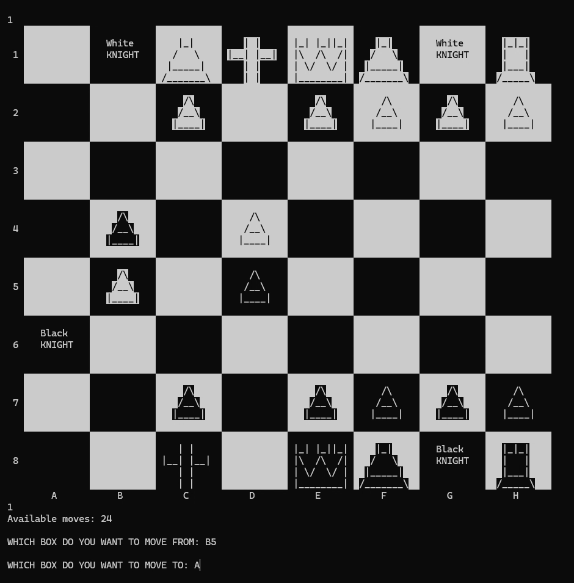

# Console Chess

A personal C++ experiment implementing a two-player chess variant in the Windows terminal, with a coloured board, piece movement checks, captures, and check-related logic.

## Demonstration



A cropped frame from the owner's existing recording. It illustrates the original terminal interface, not a fresh end-to-end test of this revision. No audio is included. [Frame provenance](docs/DEMONSTRATION.md).

## Gameplay and implementation

Enter a source and destination using uppercase columns **A–H** and rows **1–8**, for example `A2` then `A3`. The source includes promotion choices and castling-related logic. These describe the implemented variant, not a claim of complete official chess-rule compliance. The existing rule variant is preserved; no AI opponent, GUI, or online play is included.

The implementation is procedural: functions operate on an integer-encoded 8×8 board. `PieceDesign.cpp` is a separate rendering experiment, not an additional source file to link into the game.

## Build and run on Windows

The source uses `<windows.h>` and `<conio.h>` for terminal colours/input. Native Linux/macOS compilation is not claimed. Install Visual Studio with the Desktop development with C++ workload and CMake, then run:

```powershell
cmake -S . -B build
cmake --build build --config Release
.\build\Release\console-chess.exe
```

For a single-configuration generator the executable is directly under `build/`. Alternatively, from an x64 Visual Studio Developer Command Prompt:

```bat
cl /nologo /EHsc /std:c++17 /utf-8 Chess.cpp /Fe:console-chess.exe
```

Use a wide terminal for the board/card rendering. Build only the entry source named above; compiling every `.cpp` together may include multiple `main` functions.

## Validation and limitations

See [validation notes](docs/VALIDATION.md) for observed build/test results and known limitations. Build success does not establish every game rule as correct. Run focused tests with `cmake --build build --config Debug` and `ctest --test-dir build -C Debug --output-on-failure`. There is no hosted deployment.

## Project context

Personal experimental project by Syed Muhammad Rayyan Hassan.
